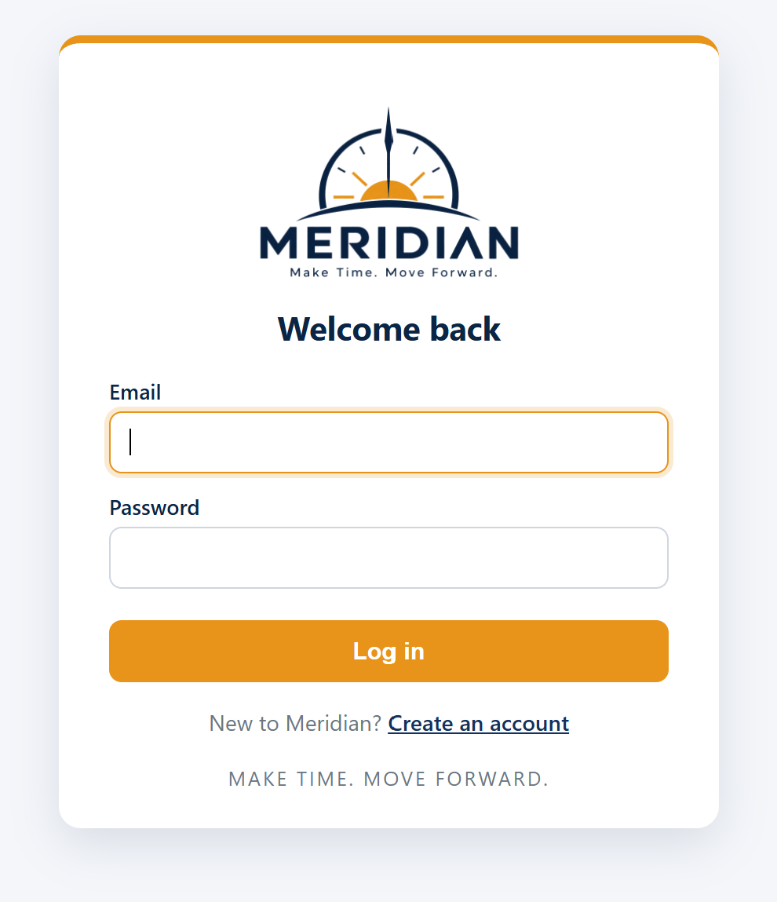
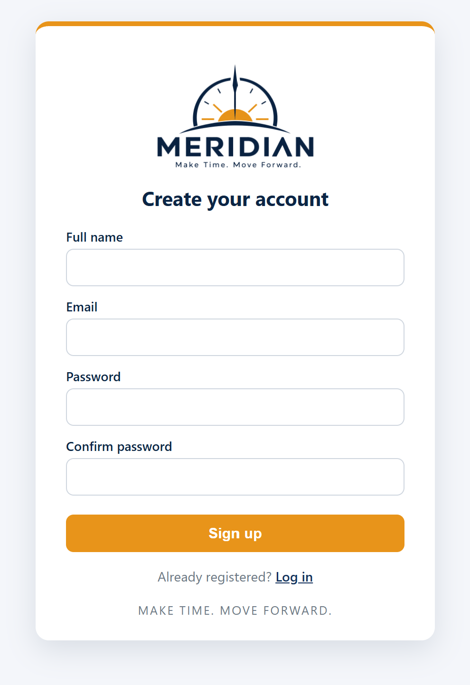
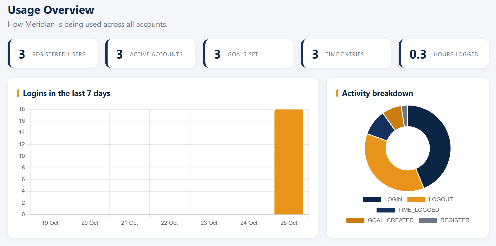
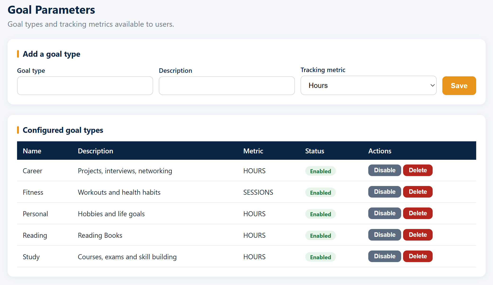
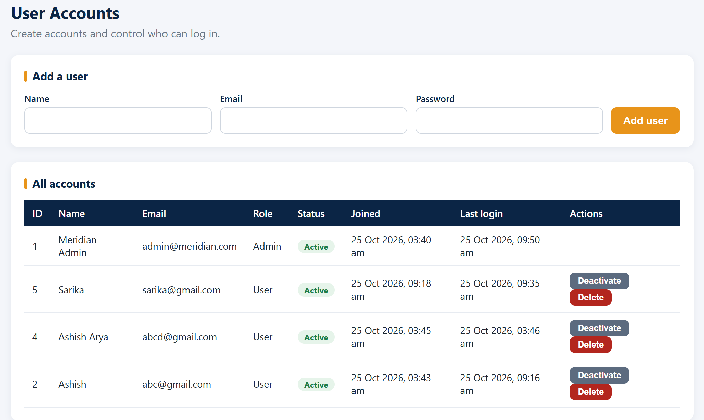
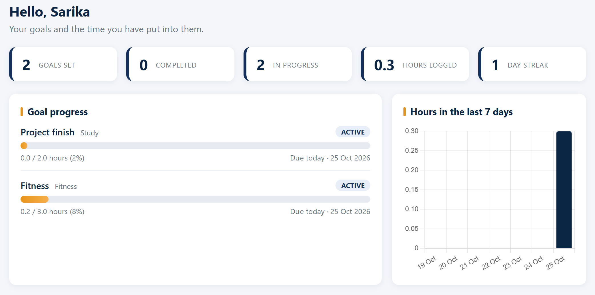
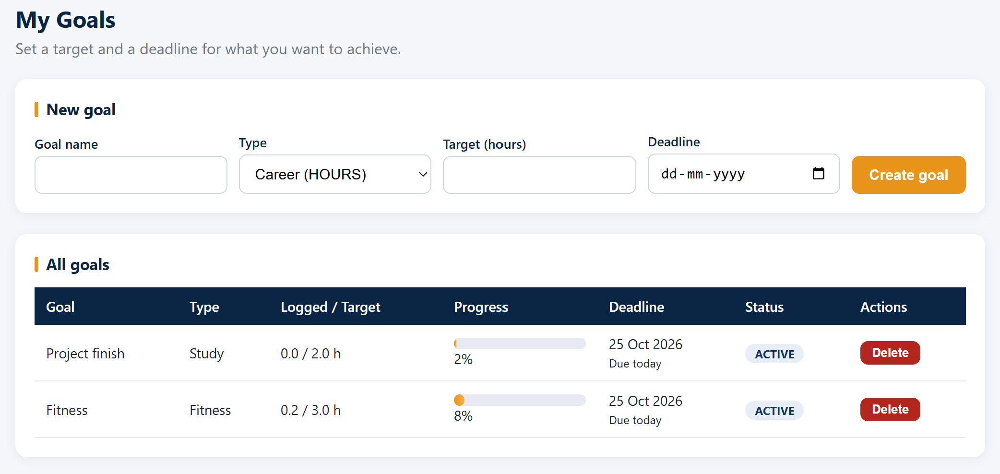
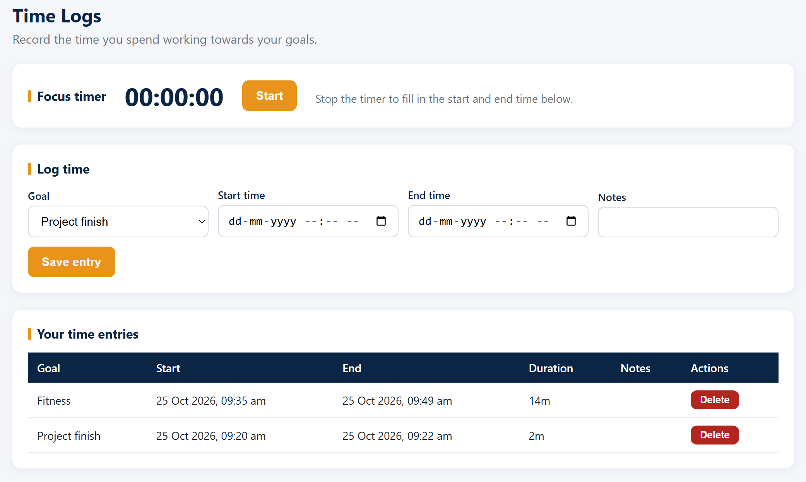
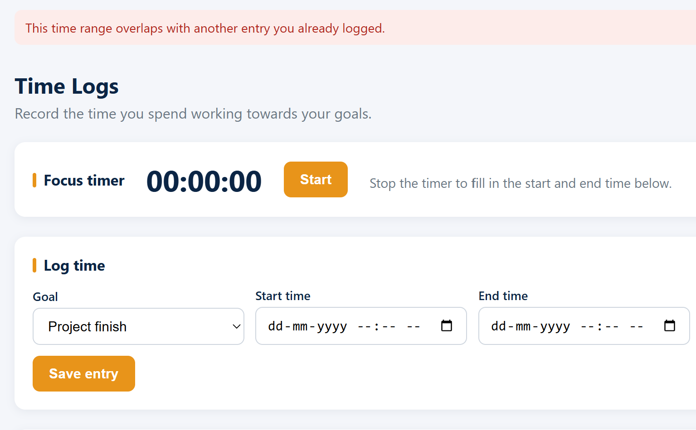

# Meridian
Make Time. Move Forward.

Meridian is a time management and goal setting tool built with Java Servlets, JSP and MySQL. Users set personal goals, log the time they spend on them and watch their progress. Admins configure goal types, manage user accounts and monitor how the tool is used.

## Features

**Admin**
- Configure goal types and tracking metrics (hours, sessions, percent)
- Manage user accounts: add, activate, deactivate and delete
- Usage overview with statistics and graphs

**User**
- Register, log in and log out
- Set personal goals with a target and a deadline
- Track time with a focus timer or manual entries, with overlap checking
- Progress dashboard with completion status, day streak and weekly hours chart
- Goals are marked completed automatically and marked overdue by a background thread

## Technologies
- Java 17
- Servlets, JSP, JSTL
- MySQL 8 with JDBC
- Apache Tomcat 10.1
- Maven, JUnit 5
- Chart.js, BCrypt

## Project structure
```
sql/schema.sql                      database schema
src/main/java/com/meridian/
    model/                          User, Admin, RegularUser, Goal, TimeEntry, GoalType
    dao/                            JDBC data access classes
    service/                        validation and business logic
    servlet/                        request handling
    filter/                         authentication and role filter
    listener/, task/                startup setup and deadline checker thread
    exception/, util/               custom exceptions and helpers
src/main/webapp/                    JSP views, CSS and images
src/test/java/com/meridian/         unit tests
docs/                               design diagrams and screenshots
```

## Login
| Role | Email | Password |
|------|-------|----------|
| Admin | admin@meridian.com | Admin@123 |
| User | Register from the login page | |

## Screenshots

| | |
|---|---|
|  |  |

**Admin**





**User**






The architecture, use case and database diagrams are in [docs/DESIGN.md](docs/DESIGN.md).

## Team
| Name | Admission No. | Role |
|------|---------------|------|
| Ashish Anand | 25SCSE1011359 | Team Leader |
| Divyanshu Raj | 25SCSE1011398 | Member |
| Raj Kumar | 25SCSE1011351 | Member |
| Aman Raz | 25SCSE1011372 | Member |
